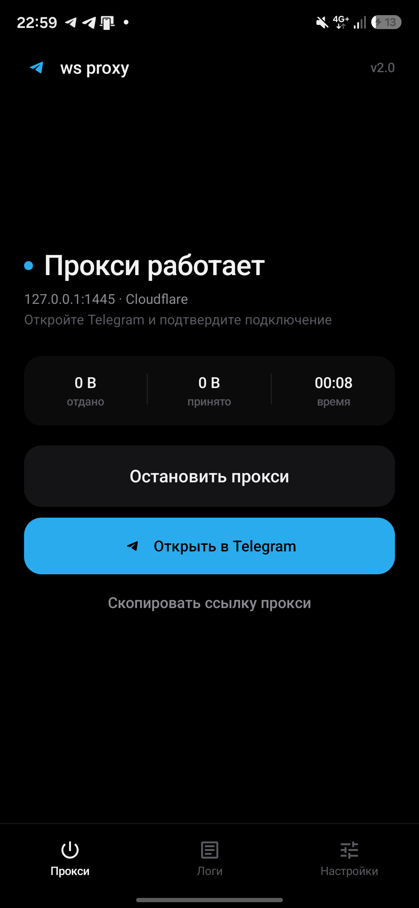
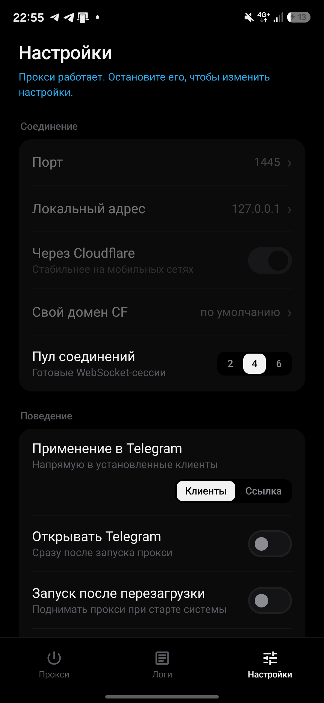
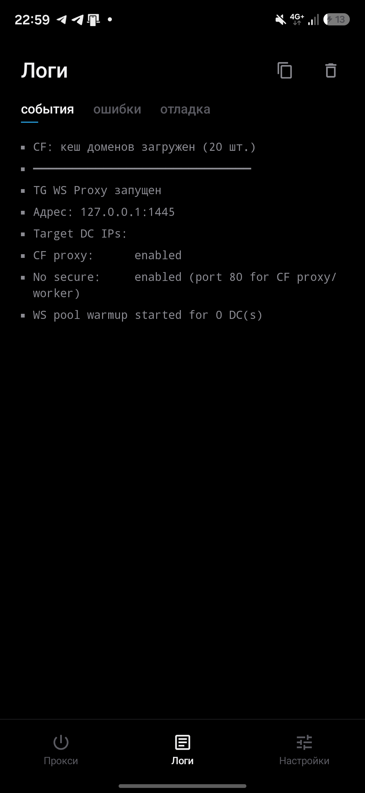

# WS Proxy — OLED Edition

Переработанная Android-версия [tg-ws-proxy](https://github.com/Flowseal/tg-ws-proxy) на базе
[форка amurcanov](https://github.com/amurcanov/tg-ws-proxy-android): локальный MTProto-прокси
для Telegram с минималистичным интерфейсом в стиле OLED.

**[Скачать APK](https://github.com/Pe4enka41/tg-ws-proxy-oled/releases/latest)**

<p align="center">
  <b>Telegram → 127.0.0.1:1445 → tgwsproxy → WSS (Cloudflare / напрямую) → Telegram DC</b>
</p>

## Что делает приложение

1. Поднимает локальный MTProto-прокси на `127.0.0.1` (порт по умолчанию `1445`) через нативное
   ядро `tgwsproxy` на Rust.
2. Telegram подключается к локальному порту по ссылке `tg://proxy` с секретным ключом.
3. Ядро извлекает DC из первого пакета и устанавливает TLS/WebSocket-соединение с нужным
   дата-центром — напрямую или через Cloudflare.
4. Работает в foreground-сервисе с wake lock, плиткой быстрых настроек и автозапуском.

## Что изменено

### Интерфейс

- Полностью новый UI: чистый чёрный фон, телеграм-синий акцент, никаких градиентов и
  «стеклянных» карточек.

| Прокси | Настройки | Логи |
| --- | --- | --- |
|  |  |  |

- Один экран управления: статус, режим, живой трафик и время работы. Никаких дублирующих
  кнопок — запуск и остановка только одной кнопкой.
- Самолётик Telegram в шапке, в кнопке «Открыть в Telegram» и в иконке приложения.
- Три экрана: **Прокси / Логи / Настройки**. Всё лишнее убрано.
- Настройки собраны в компактные группы: соединение, поведение, безопасность. Оставлено
  только нужное: порт, Cloudflare, пул, автозапуск, способ применения, язык, секрет.

### Поведение

- **Живая статистика в приложении**: отправлено, получено, время работы, число сессий. Раньше
  эти данные были только в уведомлении.
- **Watchdog**: сервис раз в 20 секунд проверяет, что нативное ядро действительно слушает порт.
  Если порт освободился (ядро молча упало), прокси автоматически перезапускается.
- **Автоприменение в Telegram** (опция): после успешного старта прокси сразу передаётся в клиент.
- **Кнопка «Запустить и открыть Telegram»**: одна кнопка запускает прокси и сразу открывает
  подтверждение в клиенте — не нужно делать два действия вручную.
- **Сохранённый способ применения**: «Клиенты» или «Ссылка» запоминается между запусками.
- Ошибки запуска показываются прямо на главном экране, а не только в уведомлении.
- Порт по умолчанию — `1445`, чтобы приложение не конфликтовало с оригиналом на `1443`.
- Уведомление показывает раздельный трафик `↑ / ↓` и число сессий.
- Язык переключается без переустановки: системный / русский / английский.
- Новый идентификатор пакета `com.tgws.oled` — ставится рядом с оригиналом.

### Что не менялось

Нативное ядро `libtgwsproxy.so` взято из оригинального проекта без изменений: в окружении сборки
нет Rust-тулчейна и Android NDK, поэтому пересобрать `.so` нельзя. Исходники ядра (`src/*.rs`)
оставлены в репозитории — их можно собрать скриптом `build_so.bat` при наличии Rust + NDK.

## Сборка

Требования: JDK 17, Android SDK 35 (platform + build-tools 35.0.0).

```properties
# local.properties
sdk.dir=C:\\Users\\<user>\\AppData\\Local\\Android\\Sdk
```

```bash
gradlew.bat :app:assembleRelease
# APK: app/build/outputs/apk/release/app-release.apk
```

Для подписи создайте `oled-release.jks` и укажите параметры в `local.properties`:

```properties
KEYSTORE_FILE=..\\oled-release.jks
KEYSTORE_PASSWORD=...
KEY_ALIAS=oled
KEY_PASSWORD=...
```

Без keystore release-сборка будет подписана debug-ключом.

## Структура

```
app/src/main/java/com/amurcanov/tgwsproxy/
├── MainActivity.kt        # тема, навигация, logcat-ридер
├── ProxyService.kt        # foreground-сервис, статистика, watchdog
├── ProxyController.kt     # старт/стоп из настроек
├── SettingsStore.kt       # DataStore
├── AppPrefs.kt            # язык (доступен до DataStore)
├── NativeProxy.kt         # JNA-обёртка над ядром
├── BootReceiver.kt        # автозапуск
├── ProxyTileService.kt    # плитка быстрых настроек
└── ui/
    ├── Theme.kt           # OLED-палитра и типографика
    ├── ConnectionTab.kt   # главный экран
    ├── SettingsTab.kt     # настройки
    ├── LogsTab.kt         # логи
    ├── TelegramApply.kt   # tg://proxy в клиенты
    └── Format.kt          # байты и длительность
src/*.rs                   # исходники нативного ядра (Rust)
```

## Лицензия

GPLv3. Оригинальная идея и ядро — [Flowseal/tg-ws-proxy](https://github.com/Flowseal/tg-ws-proxy) (MIT),
Android-форк — [amurcanov](https://github.com/amurcanov/tg-ws-proxy-android).
